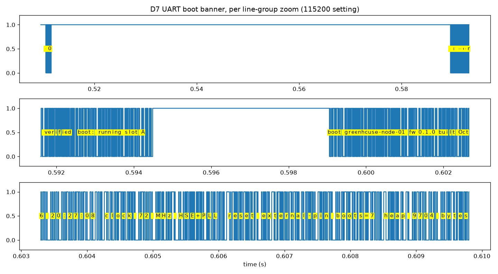

# STM32 FreeRTOS Sensor & Control Node

An STM32 greenhouse node that boots through its own bootloader, verifies its
firmware against flash before jumping, and narrates every step on the wire —
captured below with a logic analyzer, not claimed in prose. Two bootloader bugs
surfaced exactly this way (a cleared Thumb bit that HardFaulted every jump; a
32-bit marker in a 16-bit backup register that silently disabled updates) and are
fixed, measured, and logged in [docs/bring-up-log.md](docs/bring-up-log.md).



Full capture set with render script: [docs/evidence/](docs/evidence/) (raw `.sr`
for PulseView, transcripts, I2C sweep, telemetry cadence).

Firmware and hardware for a networked sensor/control node: a FreeRTOS task architecture,
analog sensing, closed-loop control, field firmware update, and industrial fieldbus I/O —
all on a **custom board designed, laid out, and brought up for this project**.

**Phases 0, 1 and 2 are implemented and verified on the host.** The five-task architecture,
the I2C arbiter and its bus-release sequence, the watchdog supervisor, the sensor
service, the DMA dirty-rectangle display path, the timer-triggered ADC acquisition path,
the PID control loop with its runtime tuning store, the 8 KB bootloader, the framed
update protocol and its host flasher, and the host test suite all exist and
pass. The target build produces a flashable image for an STM32F103C8T6.

The firmware runs on the bench board (BOOT0 strapped, app booting, HSE-started
72 MHz banner and live telemetry captured on the logic analyzer — see
[docs/evidence/](docs/evidence/)).

Requirements, phase plan, and design detail live in **[docs/design-spec.md](docs/design-spec.md)**.

## Status

| Phase | Scope | Status |
|-------|-------|--------|
| 0 | FreeRTOS sensor node: shared-bus arbitration, I2C recovery, watchdog, DMA display | **Implemented, host-verified** |
| 1 | Timer-triggered ADC + DMA, PID control loop, measured scheduling, CI | **Implemented, host-verified**; on-board boot, ADC, telemetry and I2C verified |
| 2 | Bootloader + field firmware update over a framed UART protocol | **Implemented, host-verified**; on-board boot, ladder, marker and jump verified |
| 3 | Modbus RTU over RS-485 + custom 2-layer MCU & I/O board, fabricated and brought up | Not started |
| 4 | Low-power modes with measured current draw, on the custom board (stretch) | Not started |

Phases 0-2 are developed and proven on the dev board, then ported to the custom board in
Phase 3 — so a board defect can never block firmware progress, and bring-up failures are
unambiguously hardware failures.

## Target system

```
   capacitive soil-moisture probe v2.0, 3.3 V (Phase 1)
     └─▶ AFE: input protection ─▶ op-amp buffer ─▶ RC anti-alias filter
           └─▶ ADC, timer-triggered, DMA into a double buffer
                 │
                 ▼
   ┌─ CUSTOM MCU & I/O BOARD ──────────────────────────────────────────
   │  (dev board used instead through Phase 2; this board replaces it in Phase 3)
   │
   │  MCU under FreeRTOS
   │    ├ supervisor task  feeds the IWDG, tracks task heartbeats   prio 4
   │    ├ sensor task      reads the AHT20 over I2C                prio 3
   │    ├ app task         owns application state / PID loop       prio 3
   │    ├ comms task      telemetry and commands over UART        prio 2
   │    └ display task    dirty-rectangle OLED refresh via DMA    prio 1
   │
   │  shared I2C bus ── mutex-protected arbiter, 9-clock recovery on fault
   │  power          ── input protection ─▶ 3.3 V regulation ─▶ filtered VDDA
   │  jumper         ── MCU-rail current measurement (enables Phase 4)
   └────────┬───────────────────────┬──────────────────────┬──────────
            │                       │                      │
        OLED (I2C)        gate driver ─▶ fan / pump     RS-485 ─▶ host / PLC
                                                           (Modbus RTU)
```

The node is a **greenhouse** node, and the sensor set is stated here once rather than in
three places:

| Quantity | Device | Bus | Read by |
|----------|--------|-----|---------|
| Soil moisture (**controlled**) | capacitive probe v2.0, analog out, 3.3 V | ADC1_IN0 via the anti-alias filter | acquisition service, 1 kHz timer-triggered |
| Air temperature + humidity | AHT20 at `0x38` | I2C1 | sensor task (monitored only) |
| Barometric pressure | BMP280 at `0x76` | I2C1 | **not read** — it answers the bus scan, which is all it is used for |
| Local display | SSD1306 128x64 at `0x3C` | I2C1 | display task |

The final design keeps this set: a **capacitive** soil-moisture probe is the controlled
variable, and the AHT20+BMP280 module is the ambient monitor. Phase 0 reads the AHT20 over
I2C while the Phase 1 control loop drives the analog channel, which is what makes the
shared-bus arbitration of FR-0.2 a real problem rather than a contrived one — two devices,
two tasks, one bus.

A capacitive probe is used rather than a resistive one for a reason that reaches the
firmware: it does not need a DC excitation gated on and off, so it can be powered
continuously and read at will, and its output is a voltage proportional to moisture — which
is why the controlled quantity arrives on an ADC channel and not as another I2C device.

Board design constraints, deliberately chosen to keep effort in the analog and layout
decisions rather than in assembly: two layers, leaded hand-solderable packages only
(LQFP-48 class, no BGA or fine-pitch QFN), no USB, no high-speed interfaces.

The case for a custom board at all — what the dev board cannot serve, and the
conditions under which staying on it would be the better call — is in
[design-spec.md Section 2.3](docs/design-spec.md#23-board-rationale--custom-board-versus-dev-board).

## Repository layout

```
.
├── README.md
├── CMakeLists.txt             host and target builds from one tree
├── cmake/
│   └── arm-none-eabi.cmake    toolchain file
├── docs/
│   ├── design-spec.md         requirements, phases, design
│   ├── bring-up-log.md        hardware bring-up, written as it happens
│   └── measurements.md        captured figures (jitter, latency, ENOB, ripple, ...)
├── firmware/
│   ├── FreeRTOSConfig.h
│   ├── app/                   C++ application layer, target-independent
│   │   ├── include/app/       board config, node, arbiter, supervisor, sensor, ...
│   │   └── src/
│   ├── hal/                   C hardware abstraction: interfaces, and one implementation
│   │   ├── include/hal/       i2c, gpio, uart, watchdog, system — frozen interfaces
│   │   └── stm32f1/           the F103 implementation
│   ├── rtos/                  RTOS interface, FreeRTOS binding, host double
│   ├── boot/                  the Phase 2 bootloader: layout/CRC/metadata/decision/
│   │                          frame (host-tested boot_core) plus the 8 KB image
│   └── third_party/           pinned vendored sources, with provenance
├── host/                      Python: flasher, telemetry, step-response plots, Modbus client
├── hardware/
│   ├── afe/                   Phase 1 breadboard analog front end (empty)
│   └── mcu-board/             Phase 3 custom board (empty)
└── tests/                     host-side unit tests for target-independent logic
    └── support/               HAL and RTOS doubles
```

`firmware/rtos/` is an addition to the layout the design spec originally listed; the
reasoning is in
[design-spec.md Section 5.2](docs/design-spec.md#52-module-boundaries).

## Build and test

### Host build — the tests (FR-0.6)

No board and no ARM toolchain needed. This is what CI runs.

```sh
cmake -B build -G Ninja
cmake --build build
ctest --test-dir build --output-on-failure
```

The suite builds the application core with `-Werror` and the full `-Wconversion` set,
and runs under AddressSanitizer and UndefinedBehaviorSanitizer. GoogleTest is fetched at
configure time, which is the only step that needs the network.

The I2C and RTOS doubles are not stubs: the bus double detects two transfers in flight
at once, and the RTOS double is backed by a real `std::timed_mutex` so the FR-0.2
contention test runs genuine threads.

### Target build — the firmware

```sh
cmake -B build-arm -G Ninja -DCMAKE_TOOLCHAIN_FILE=cmake/arm-none-eabi.cmake
cmake --build build-arm
```

The toolchain file searches for `arm-none-eabi-gcc` on `PATH`, under
`~/.platformio/packages/`, and in `/usr/bin`, so no root install is required. Point
`-DSTM32_TOOLCHAIN_DIR=/path/to/bin` at any other location.

Output: `build-arm/firmware.elf`, `firmware.hex`, `firmware.bin`, and `firmware.map`
(the application at 0x08000000, for direct SWD flashing and bring-up), plus
`firmware.slot.elf`/`firmware.slot.bin` — the **same application linked at a slot base
(0x08002000, 56 KB)**, which is the artifact the Phase 2 update path expects and
`host/flasher.py` uploads. Also `firmware/boot/bootloader.elf`/`bootloader.bin`, the
8 KB bootloader at 0x08000000. The post-build steps report each image's size.

The linker script is `firmware/stm32f103c8t6.ld`, sized for the part number's rated 64 KB,
with its slot twin `stm32f103c8t6_slot.ld`; a host test keeps both (and the bootloader's
script) in agreement with the layout authority `firmware/boot/include/boot/layout.h`
(NFR-2.9). The board on the bench reports **128 KB** and has been shown to hold data
above the 64 KB mark; the slot build uses the real budget while the direct-flash build
stays datasheet-bounded. See [docs/bring-up-log.md](docs/bring-up-log.md).

### Flash and update

Two ways onto a board, matching the two images:

- **Direct (bring-up, no bootloader):** SWD with a bare ST-Link:
  ```sh
  st-flash --reset write build-arm/firmware.bin 0x08000000
  ```
- **Field update (Phase 2):** the bootloader at 0x08000000 plus the host flasher.
  First install the bootloader over SWD once:
  ```sh
  st-flash --reset write build-arm/firmware/boot/bootloader.bin 0x08000000
  ```
  Then, from the running application, the `update` command on the host link resets into
  the bootloader's update mode, and the flasher completes the job:
  ```sh
  ./host/flasher.py --port /dev/ttyUSB0 --image build-arm/firmware.slot.bin
  ./host/flasher.py --port /dev/ttyUSB0 --info   # HELLO + metadata
  ```

If the ST-Link's NRST line is not wired to the target — which is the case on the bench
board, and what `st-flash` reports as *"NRST is not connected"* — every reset becomes a
software reset through `AIRCR`. That works for flashing, but it means `--connect-under-reset`
is unavailable and the reset button is the only way to force a hardware reset. The
SWD recovery path is documented in design-spec.md §7.7 (NFR-2.8).

### Host link

The comms task runs a small text command set at 115200 8N1 on USART1 (PA9/PA10):

| Command | Effect |
|---------|--------|
| `ver` | Firmware version and node name |
| `stat` | Every counter: bus transfers, failures, recoveries, contentions, timeouts, display bytes, sensor results, watchdog feeds, worst lateness |
| `recover` | Force the FR-0.3 nine-clock bus release now, rather than waiting to catch one |
| `timing` | The NFR-1.8/1.9 report (period jitter, ISR latency): sends a published window, or asks for a snapshot of the running one |
| `update` | Phase 2 handshake: set the update marker in the backup domain and reset into the bootloader, whose 30 s update window then awaits `host/flasher.py` |
| `help` | List the commands |

Telemetry lines are emitted once a second:
`T=23.45C RH=53.12% seq=17 bus=412/0 rec=1 feeds=48`.

## Documentation that matters most

- **[docs/design-spec.md](docs/design-spec.md)** — requirements with IDs and a
  verification method each, phase-by-phase design, risk register, effort and cost.
- **[docs/measurements.md](docs/measurements.md)** — the figures each phase must
  produce, with the host-verified ones filled in and the bench ones still open.
- **[docs/bring-up-log.md](docs/bring-up-log.md)** — the ordered bring-up sequence,
  to be recorded as bring-up happens. This is the most useful document here for anyone
  reviewing the hardware work.
- **[firmware/third_party/README.md](firmware/third_party/README.md)** — the pinned
  upstream versions, their commits, and exactly what was pruned from each.
